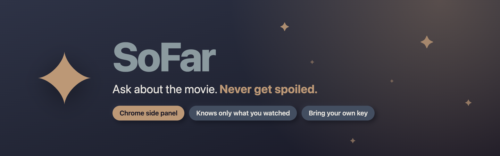
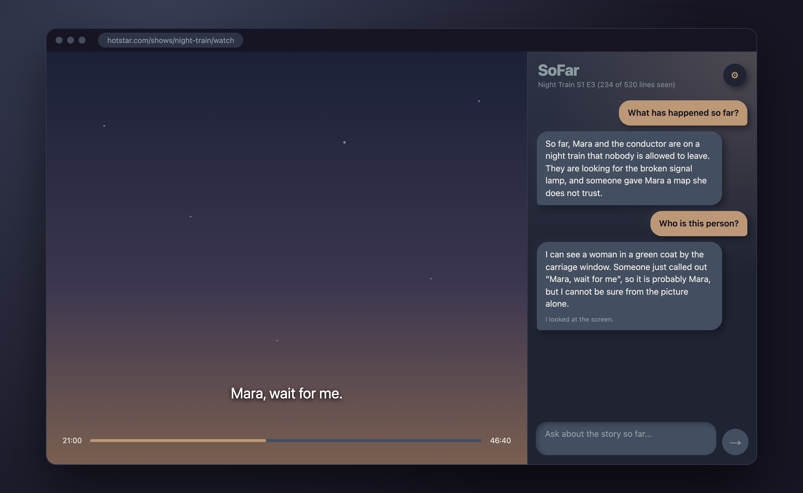
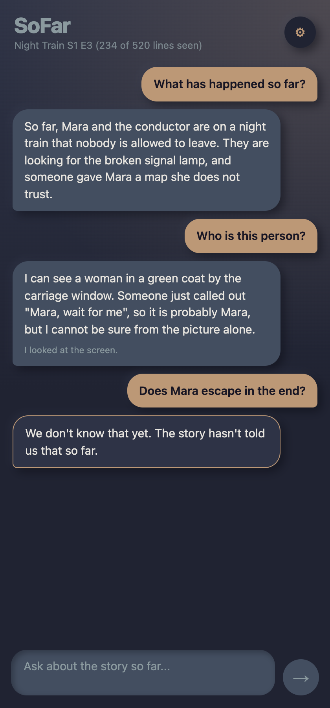
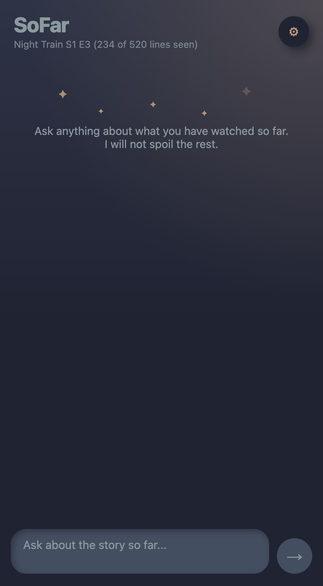
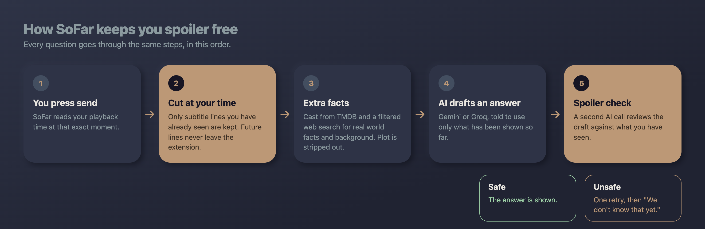
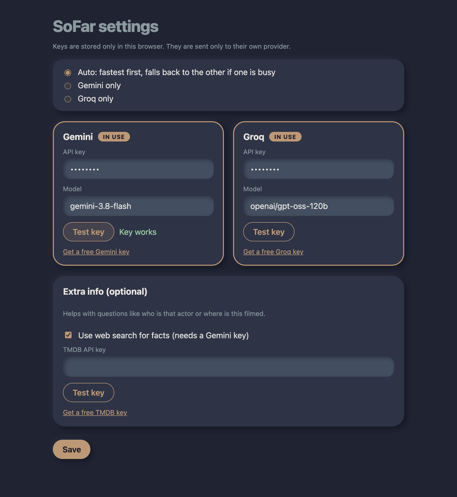

<p align="center">
  
</p>

<p align="center">
  
  
  
  
  
</p>

## Why this exists

You are halfway through a movie and wonder who that character is.
You Google it.
Google shows you how the story ends.

SoFar is a chat that sits next to the video and **only knows what you have watched so far**.
Ask it anything.
If the answer is later in the movie, it says "We don't know that yet."

<p align="center">
  
</p>

> The screenshots in this README use a made-up show ("Night Train") and mocked AI replies, so no real show is shown.
> They are rendered from the real UI code. You can regenerate them with `npm run screenshots`.

## What it can do

- **Answers from what you have seen.** It reads the subtitles of the title you are watching and cuts them at your current playback time. Rewind and it knows less.
- **Knows who is on screen.** It reads the last 20 seconds of dialogue. For questions like "who is this person?" it also looks at a screenshot of the current frame.
- **Checks every answer for spoilers.** A second AI call reviews the draft. If it is unsafe, the AI retries once, then falls back to "We don't know that yet."
- **Explains things outside the movie.** Ask "what are elves?" or "what happened in the last movie?". It searches, strips out the plot, and fits the answer to how far you have watched.
- **Cast and crew.** Optional TMDB lookup for who plays whom.
- **Two AI providers.** Gemini and Groq. Add one or both. It tries the faster one first and falls back if one is busy.
- **Bring your own key.** No server, no account, no subscription.

<p align="center">
  
  &nbsp;&nbsp;
  
</p>

## How it stays spoiler free

<p align="center">
  
</p>

The safety rules, in order of importance:

1. **Future subtitles never leave your browser.** Only lines that already started are sent to any AI, search, or checker.
2. **The cut happens when you press send**, not when you opened the panel.
3. **The AI is told not to use its own memory** of the movie, and never to hint at what comes next.
4. **A separate spoiler checker** reviews every answer. If the checker fails or cannot be read, the answer is not shown.
5. **Web notes are filtered** before they reach the answer, and the checker still reviews the final text.
6. **After a rewind, old chat turns from "the future" are forgotten.**

No system is perfect. Web results about a movie's world can sometimes mention the plot, and the filter and checker catch most of it but not all. If you see a leak, please open an issue.

## Install

### Option A: from a release (easiest)

1. Download `sofar-0.1.0-chrome.zip` from the [Releases page](https://github.com/Yuvraj06/SoFar/releases).
2. Unzip it. You get a folder.
3. In Chrome, open `chrome://extensions`.
4. Turn on **Developer mode** (top right).
5. Click **Load unpacked** and choose the unzipped folder.
6. Pin SoFar from the puzzle piece menu if you like.

### Option B: from source

```bash
git clone https://github.com/Yuvraj06/SoFar.git
cd SoFar
npm install
npm run build
```

Then load the `.output/chrome-mv3` folder with **Load unpacked** as above.

## Set it up (2 minutes)

1. Click the SoFar icon. The side panel opens.
2. Click **Set up your key** (or the gear icon).
3. Paste a free API key from [Google AI Studio](https://aistudio.google.com/apikey) (Gemini), [Groq](https://console.groq.com/keys), or both.
4. Click **Test key**, then **Save**.
5. Optional: add a free [TMDB key](https://www.themoviedb.org/settings/api) for cast info.

Using both keys is a good idea. Free plans have rate limits, and SoFar switches to the other provider when one is busy.

<p align="center">
  
</p>

## Use it

1. Open a title on JioHotstar and press play.
2. Open the SoFar side panel.
3. Wait for the line under the title to say how many subtitle lines you have seen.
4. Ask a question and press Enter.

Good things to ask:

| You ask | What SoFar does |
|---|---|
| "What has happened so far?" | Summarises from the lines you have seen |
| "Who is this person?" | Uses recent dialogue and a screenshot of the frame |
| "Who plays the doctor?" | Looks up cast info |
| "What are elves?" | Explains the idea in general, fitted to your point in the movie |
| "What happened in the last movie?" | Recaps the earlier movie or season, clearly labelled |
| "Does he survive?" | "We don't know that yet." |

## Privacy

- API keys are stored in `chrome.storage.local` only. They are never synced and never logged.
- There is no SoFar server and no analytics. Everything runs in the extension.
- Each key is sent only to its own provider.
- What leaves your browser when you ask a question:
  - your question and the subtitle lines you have **already seen**, sent to Gemini or Groq
  - a screenshot of the current frame, only for questions about the screen, sent to Gemini
  - a short search query (no transcript), sent to Google Search through Gemini, only for general or earlier-movie questions
  - the title name, sent to TMDB for cast info
- Permissions are kept narrow: JioHotstar, the AI providers, TMDB, and `activeTab` for the screenshot.

## Known limits

- **JioHotstar only for now.** Netflix and Prime Video are next.
- **Subtitles have no speaker names.** SoFar guesses who is talking from names in the dialogue and says when it is unsure.
- **Screenshots can come out black** on some computers because the video is DRM protected. SoFar detects this and uses subtitles only.
- **Ads** are not handled. During an ad, the time SoFar sees is the ad's time.
- **Titles without English subtitles** cannot be followed.
- **Groq free plans are small.** Groq gets a shorter transcript (the newest lines) to stay under its per minute limit. Gemini gets the whole thing.
- **Web search needs a Gemini key** for earlier-movie recaps.

## Development

```bash
npm install
npm run dev          # opens Chrome with the extension loaded and reloads on save
npm test             # unit tests (parsing, cutting, prompts, failover, search, spoiler rules)
npm run compile      # type check
npm run build        # production build in .output/chrome-mv3
npm run zip          # build and zip to .output/ for sharing
npm run screenshots  # regenerate the images in docs/images
```

### Project layout

Code is grouped by feature, not by type.
Entrypoints are thin. The real logic lives in `features/`.

```
entrypoints/
  background.ts          finds the subtitle manifest, opens the side panel
  hotstar.content.ts     reads the video time and page title
  sidepanel/             mounts the chat
  options/               mounts the settings page
features/
  subtitles/             parse .vtt, cut at time, per site readers (hotstar/)
  chat/                  chat UI, prompts, the answer flow
  ai/                    Gemini and Groq adapters, failover, model fallback
  search/                TMDB, filtered web search, fact gathering
  spoiler-check/         the checker step
  settings/              keys, provider choice, settings UI
shared/                  message types, theme
scripts/                 screenshot and graphics generator
```

### Adding a new site

A site reader must provide three things: the subtitle cues, the current time, and the title.
See `features/subtitles/hotstar/` for the shape.

## Roadmap

- [x] Hotstar subtitle reader
- [x] Chat with Gemini and Groq
- [x] Spoiler checker
- [x] TMDB facts and filtered web search
- [x] Who is on screen (dialogue and screenshots)
- [x] Earlier movie and general background lookups
- [ ] Netflix
- [ ] Prime Video

## Disclaimer

SoFar is an independent project. It is not affiliated with JioHotstar, Netflix, Prime Video, Google, Groq, or TMDB.
It reads the subtitle file that the page itself loads for you, and it does not touch the video or audio.
This product uses the TMDB API but is not endorsed or certified by TMDB.
